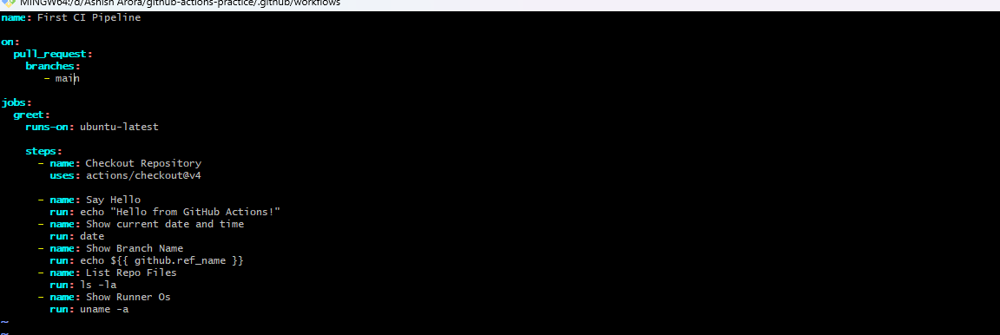
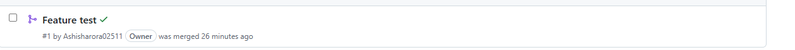
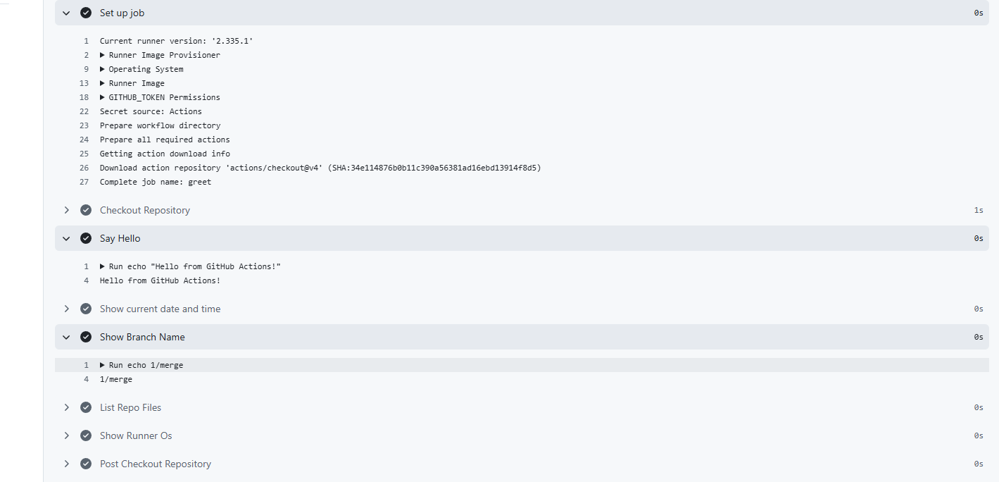
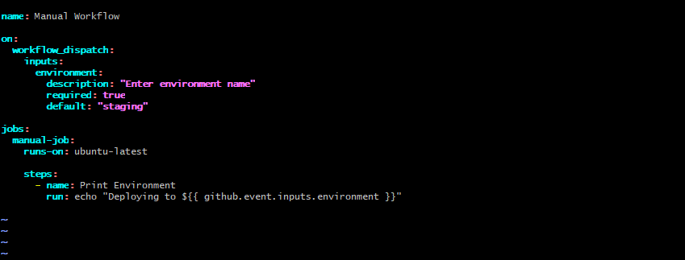
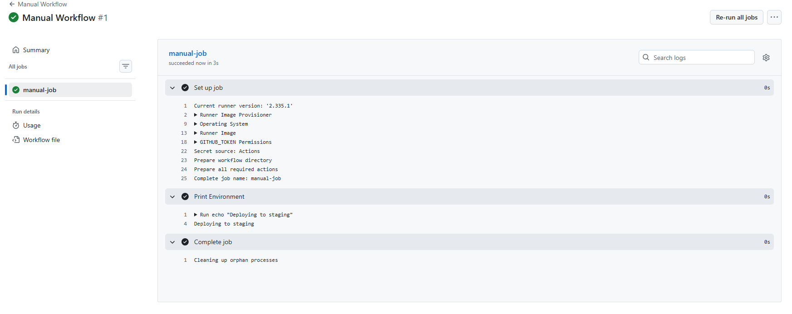
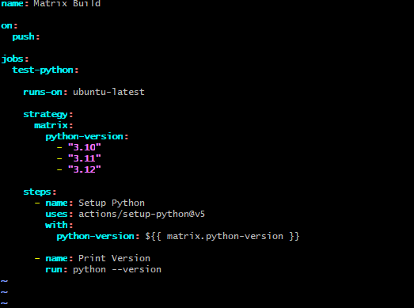
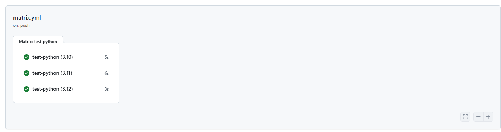
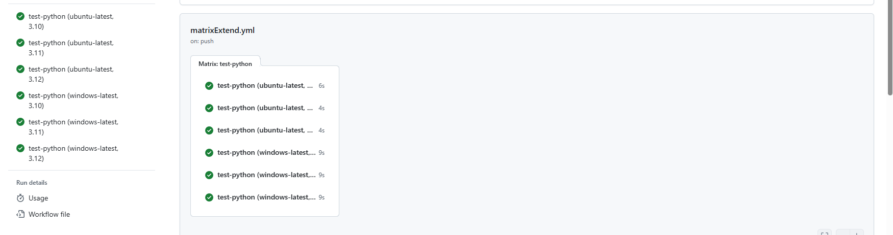

# Day 41 – Triggers & Matrix Builds

## Task
Your pipeline runs on push. Today you learn **every way to trigger a workflow** and how to run jobs across multiple environments at once.

## Challenge Tasks

### Task 1: Trigger on Pull Request
 -  Create Workflow File
 - 
 - Create Feature Branch
 - Create Pull Request
 - 
 - Verification
  - Workflow automatically started.
  - Workflow appeared in the Actions tab.
  - Workflow status appeared on the Pull Request page.
- 
### Task 2: Scheduled Trigger
 - Add a schedule: trigger to any workflow using cron syntax
 - Set it to run every day at midnight UTC
 - What is the cron expression for every Monday at 9 AM?
 - cron expression for every Monday at 9 AM is 0 9 * * 1
 - [Schedule](PipeLine/Schdeule.yml)
### Task 3: Manual Trigger
 - create Workflow File with manual deployment.
 - 
 - Run job with given inputs.
 - 
 - File is here 
 - [Manual File](PipeLine/ManualFile.yml)
 ### Task 4: Matrix Builds
 - Uses a matrix strategy to run the same job across:Python versions: 3.10, 3.11, 3.12
 - 
 - Watch all 3 run in parallel
 - 
 - Extends the matrix to include 2 os - how many total jobs runs now ?
 - 6 jobs are running
 - 
 - Files are here 
 - [Matrix](PipeLine/Matrix.yml)
 - [MatrixExtends](PipeLine/MatrixExtend.yml)
### Task 5: Exclude & Fail-Fast
1. exclude the window veriosn 3.11
2. Set `fail-fast: false` — trigger a failure in one job and observe what happens to the rest
3. Write in your notes: What does `fail-fast: true` (the default) do vs `false`?
  - fail-fast: true (default): If one job fails, the remaining matrix jobs are cancelled.
  - fail-fast: false: If one job fails, the other jobs continue running until completion.