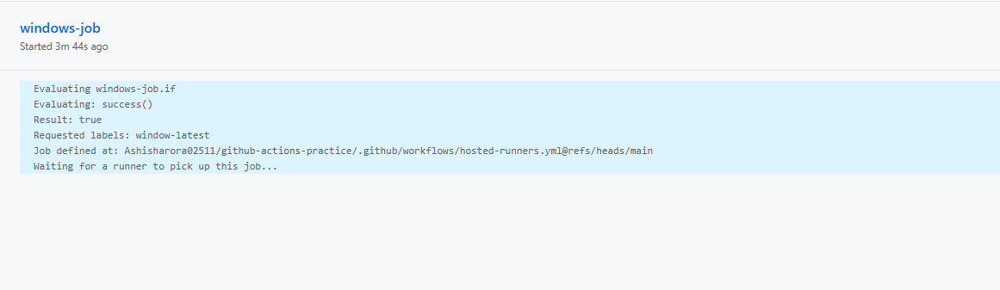
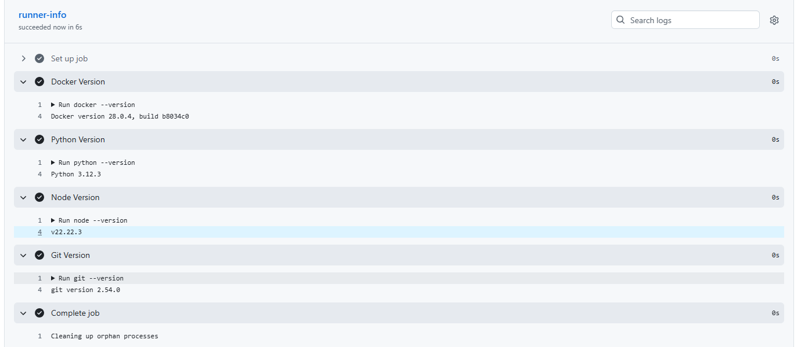
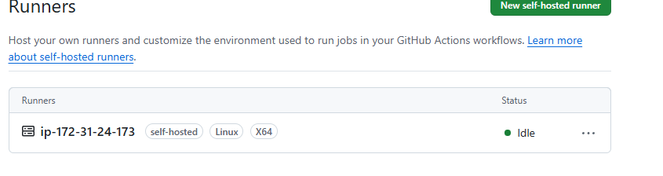
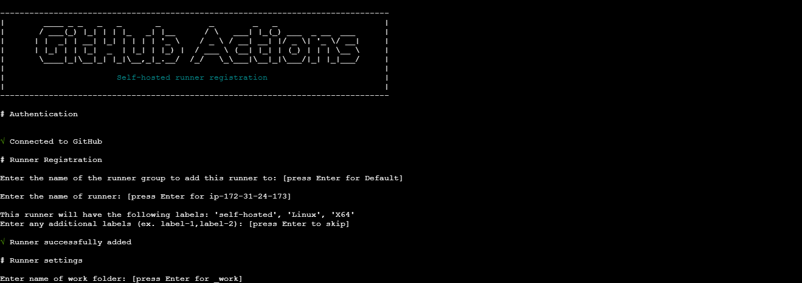
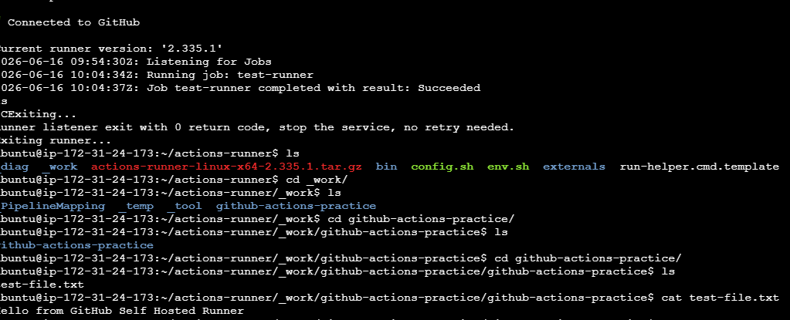
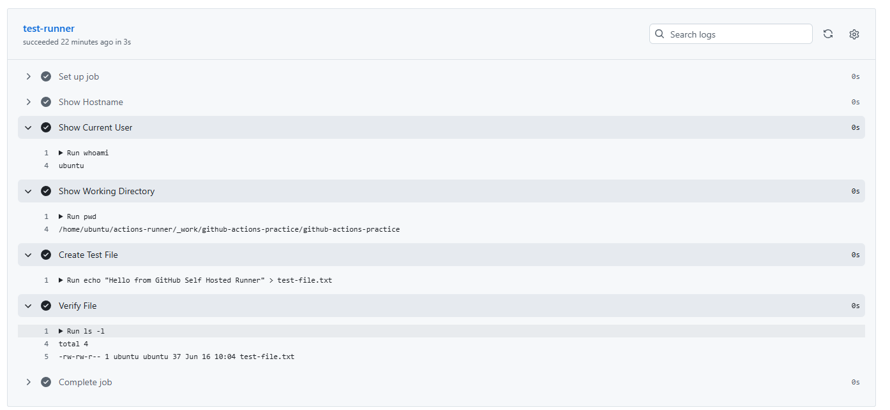
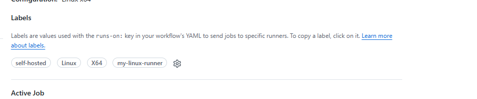
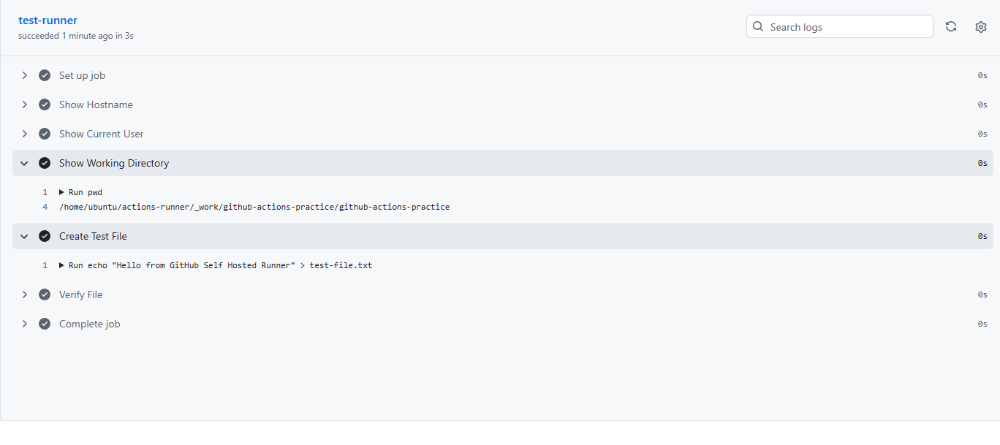

# Day 42 – Runners: GitHub-Hosted & Self-Hosted

## Task
Every job needs a machine to run on. Today you understand **runners** — GitHub's hosted ones and how to set up your own self-hosted runner on a real server.
## Challenge Tasks

### Task 1: GitHub-Hosted Runners
1. Create a workflow with 3 jobs, each on a different OS:
   - `ubuntu-latest`
   - `windows-latest`
   - `macos-latest`
2. In each job, print:
   - The OS name
   - The runner's hostname
   - The current user running the job
3. Watch all 3 run in parallel

- Runining parell jobs
- 
- [Runner-Hosted](Actions/Runner-Hosted.yml)

- What is a GitHub-hosted runner? Who manages it?
  - A GitHub-hosted runner is a temporary virtual machine provided and managed by GitHub that executes workflow jobs. GitHub creates the machine, runs the  workflow, and removes it after the job completes.
### Task 2: Explore What's Pre-installed
- On the ubuntu-latest runner, run a step that prints: docker,python,node.
- 
- [Pre-Install-Runner](Actions/Pre-Install-runner.yml)
- Why does pre-installed software matter on runners?
Pre-installed tools reduce setup time, speed up workflow execution, and simplify pipeline configuration because common development tools are already available on the runner.

### Task 3: Set Up a Self-Hosted Runner
1. Go to your GitHub repo → Settings → Actions → Runners → **New self-hosted runner**
2. Choose Linux as the OS
3. Follow the instructions to download and configure the runner on:
   - Your local machine, OR
   - A cloud VM (EC2, Utho, or any VPS)
4. Start the runner — verify it shows as **Idle** in GitHub
5. Check runner is in idle state a wait for job to run .
- Verify: Your runner appears in the Runners list with a green dot.
- 
- 
### Task 4: Use Your Self-Hosted Runner
1. Create `self-hosted.yml`
2. Set `runs-on: self-hosted`
3. Add steps that:
   - Print the hostname of the machine (it should be YOUR machine/VM)
   - Print the working directory
   - Create a file and verify it exists on your machine after the run
4. Trigger it and watch it run on your own hardware
- 
- 
- [self-hosted](Actions/self-hosted.yml)
### Task 5: Labels
1. Add a **label** to your self-hosted runner (e.g., `my-linux-runner`)
2. Update your workflow to use `runs-on: [self-hosted, my-linux-runner]`
3. Trigger it — does it still pick up the job?
-   
- 
Why are labels useful when you have multiple self-hosted runners?
- Labels are useful when you have multiple self-hosted runners because they help GitHub Actions choose the correct runner for a specific job
### Task 6: GitHub-Hosted vs Self-Hosted
Fill this in your notes:

| | GitHub-Hosted | Self-Hosted |
|---|---|---|
| Who manages it? | Managed by Github | Managed by you |
| Cost | free for public repositories. For private repositories,costs depend on your GitHub plan and the runner's operating system | You pay for the infrastructure (server/VM like EC2) |
| Pre-installed tools | Many tools pre-installed (Docker,Node,Java,Python, etc.) | You install and manage the tools yourself |
| Good for | Quick setup, standard CI/CD workloads | Custom environments, private networks, heavy workloads|
| Security concern | Code runs on GitHub-managed infrastructure| You must secure and maintain the server yourself |
