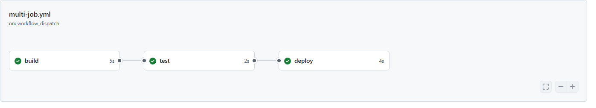
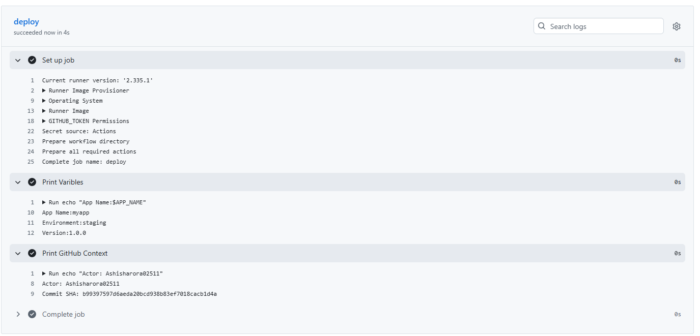
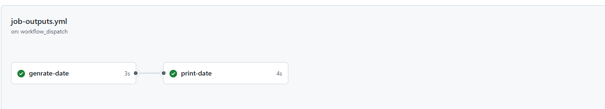
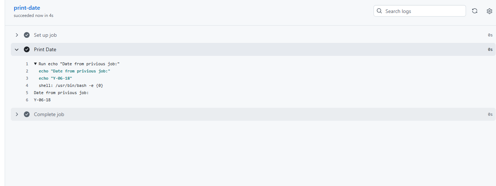
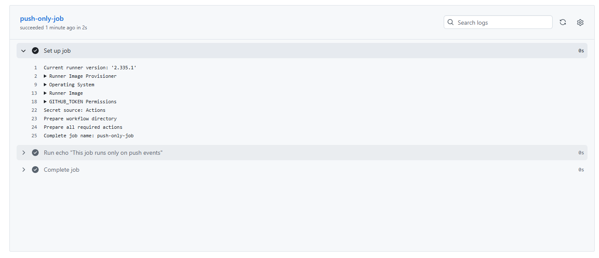
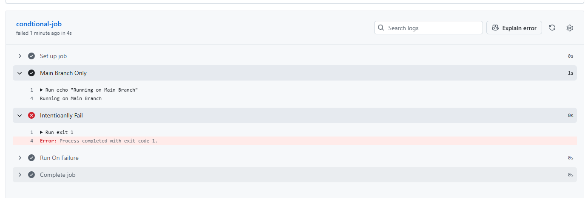
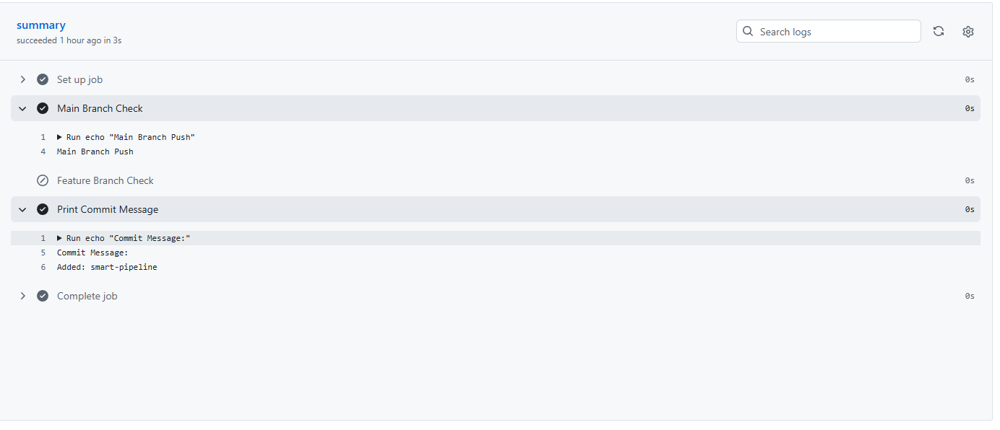

# Day 43 – Jobs, Steps, Env Vars & Conditionals

## Task
Today you learn how to **control the flow** of your pipeline — multi-job workflows, passing data between jobs, environment variables, and running steps only when certain conditions are met.
## Challenge Tasks

### Task 1: Multi-Job Workflow
Create `.github/workflows/multi-job.yml` with 3 jobs:
- `build` — prints "Building the app"
- `test` — prints "Running tests"
- `deploy` — prints "Deploying"

Make `test` run only **after** `build` succeeds.
Make `deploy` run only **after** `test` succeeds.

**Verify:** Check the workflow graph in the Actions tab — does it show the dependency chain?
- Yes It show the dependency chain
- 
- [Multi-Jobs](Workflows/Multi-jobs.yml)
### Task 2: Environment Variables
In a new workflow, use environment variables at 3 levels:
1. **Workflow level** — `APP_NAME: myapp`
2. **Job level** — `ENVIRONMENT: staging`
3. **Step level** — `VERSION: 1.0.0`
- Print all three in a single step and verify each is accessible.
- Then use a **GitHub context variable** — print the commit SHA and the actor (who triggered the run).
- 
- [Envs-Variable](Workflows/envs.yml)
### Task 3: Job Outputs
1. Create a job that **sets an output** — e.g., today's date as a string
2. Create a second job that **reads that output** and prints it
3. Pass the value using `outputs:` and `needs.<job>.outputs.<name>`
- 
- 
- [JobsOutputs](Workflows/job-output.yml)
Write in your notes: Why would you pass outputs between jobs?
- Jobs in GitHub Actions often run on different runners (different machines). Because of this, a variable created in one job is not automatically available  in another job.
- Job outputs allow us to pass data generated in one job to another job.
- One job generates information.
- Another job needs that information.
- Jobs run on different runners.
- Environment variables alone are not sufficient.
### Task 4: Conditionals
In a workflow, add:
1. A step that only runs when the branch is `main`
2. A step that only runs when the previous step **failed**
3. A job that only runs on **push** events, not on pull requests
4. A step with `continue-on-error: true` — what does this do?
- 
- 
- continue-on-error: true tells the workflow not to fail even if a step or job fails. The workflow continues executing the remaining steps or jobs.
- [text](Workflows/condtional.yml)
### Task 5: Putting It Together
Create `.github/workflows/smart-pipeline.yml` that:
1. Triggers on push to any branch
2. Has a `lint` job and a `test` job running in parallel
3. Has a `summary` job that runs after both, prints whether it's a `main` branch push or a feature branch push, and prints the commit message
- .png>)
- 