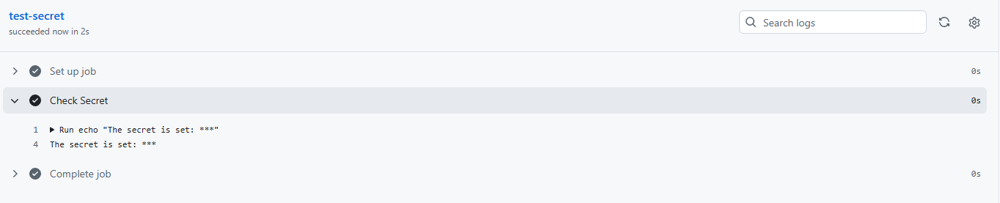
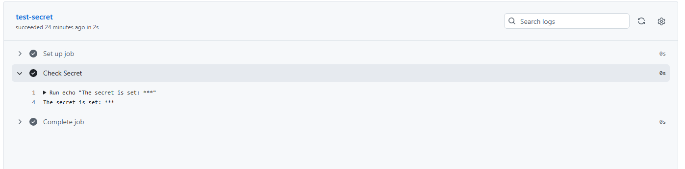
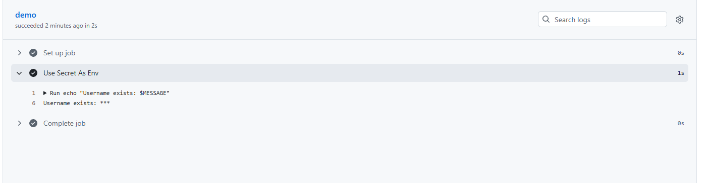

# Day 44 – Secrets, Artifacts & Running Real Tests in CI

## Task
Today your pipeline starts doing **real work** — storing sensitive values securely, saving build outputs, and running actual tests from your previous days.
## Challenge Tasks


## Task 1: GitHub Secrets

### What is a Secret?
A GitHub Secret is an encrypted value stored securely in GitHub and used inside workflows without exposing sensitive information.
### Why Use Secrets?
Secrets prevent passwords, tokens, API keys, and credentials from being hardcoded in workflow files.
### Observation
When attempting to print a secret directly, GitHub automatically masked the value and displayed `***` in workflow logs.
### Why Should Secrets Never Be Printed?
Secrets may contain sensitive credentials. Printing them in CI logs can expose infrastructure and create security risks.
- 
- 
- [Secret-Test](Workflow/secret-test.yml)

### Task 2: Use Secrets as Environment Variables
- Secrets Created: MY_SECRET_MESSAGE
```file 

Workflow Example
- name: Use Secret As Environment Variable

  env:
    USERNAME: ${{ secrets.DOCKER_USERNAME }}

  run: |
    echo "Username: $USERNAME"

```
###  What I Learned
- GitHub Secrets store sensitive information securely, such as passwords, API keys, and access tokens.

 Secrets can be used directly:
 ```file  ${{ secrets.DOCKER_USERNAME }} ```
 or passed as environment variables:
 env:
  USERNAME: ${{ secrets.DOCKER_USERNAME }}
- Environment variables make workflows cleaner and easier to maintain, especially when a secret is used multiple times within a script.
####  Why Use Environment Variables?
- Instead of repeatedly writing ```file${{ secrets.DOCKER_USERNAME }}``` we can assign it once to an environment variable and use: $USERNAME
throughout the script.
#### Key Takeaway
GitHub Secrets provide secure storage for sensitive information, while environment variables make those secrets accessible to commands and applications during workflow execution without exposing them in source code.
- 
- [Secret-env](Workflow/Secret-env.yml)
### Task 3: Upload Artifacts
#### Objective
Learn how to preserve files generated during a workflow by uploading them as GitHub Artifacts.
- [Artifact-Workflow](Workflow/Artifact-upload.yml)

#### What I Learned
GitHub runners are temporary machines. Any files created during a workflow are deleted when the runner is destroyed.
Artifacts allow us to save important files such as:
#### Observation
The workflow created a file named report.txt and uploaded it as an artifact named test-report.
The artifact was available for download from the Actions tab after the workflow completed.
#### Key Takeaway
Artifacts provide a way to persist files beyond the lifetime of a workflow runner and make them available for later download or use.
### Task 4: Download Artifacts Between Jobs
 - Workflow Example
 Job 1 creates a file and uploads it as an artifact.
 Job 2 downloads the artifact and uses the file.
 - Workflow: [Artifacts-Between-Chnages](Workflow/Artifact-between-jobs.yml)
 - What I Learned: Artifacts allow files created in one job to be downloaded and used by another job, even when jobs run on different runners.
 - When Would You Use Artifacts?
   Passing build outputs between jobs
   Sharing test reports
   Storing logs
   Preserving deployment packages
   Publishing coverage reports
 - Key Takeaway:
     Artifacts are the preferred way to transfer files between jobs because runners are temporary and do not share files directly.
### Task 5: Run Real Tests in CI
Take any script from your earlier days (Python or Shell) and run it in CI:
 #### Objective
Learn how Continuous Integration (CI) automatically runs project code or tests whenever changes are pushed to the repository.
- [Workflow](Workflow/python-test-workgflow.yml)
#### What I Learned
GitHub Actions does not automatically know whether my code is correct or incorrect.
Instead, it simply executes the commands defined in the workflow. In this task, GitHub Actions checked out my repository, installed Python, and executed hello.py.
If the script runs successfully, it returns Exit Code 0, and the workflow passes.
If the script throws an exception or exits with a non-zero exit code, GitHub marks the workflow as failed.
#### Why actions/checkout Is Required
GitHub runners are temporary virtual machines and do not contain my project files.
The actions/checkout@v4 action clones the repository into the runner so that files such as hello.py are available during workflow execution.
Without checkout, the runner cannot find project files and the workflow fails with errors like:
python: can't open file 'hello.py': No such file or directory
#### Key Takeaways
CI automatically executes project code after every push or workflow trigger.
GitHub Actions does not verify business logic itself; it only runs the commands we specify.
A successful command returns Exit Code 0, while a failed command returns a non-zero exit code, causing the workflow to fail.
The repository must first be checked out onto the runner before project files can be executed.