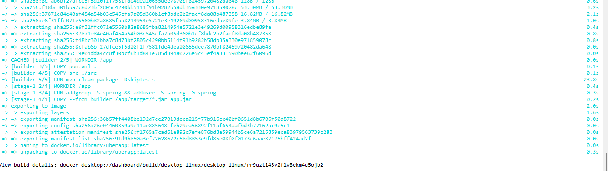
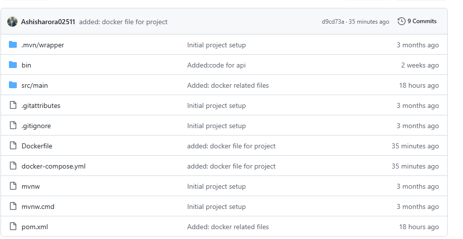
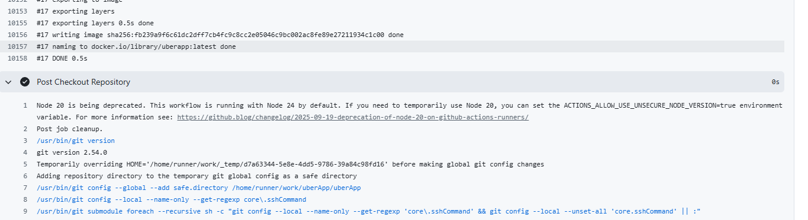
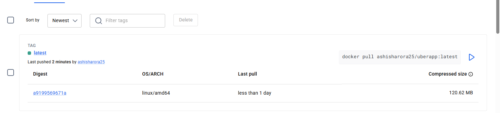
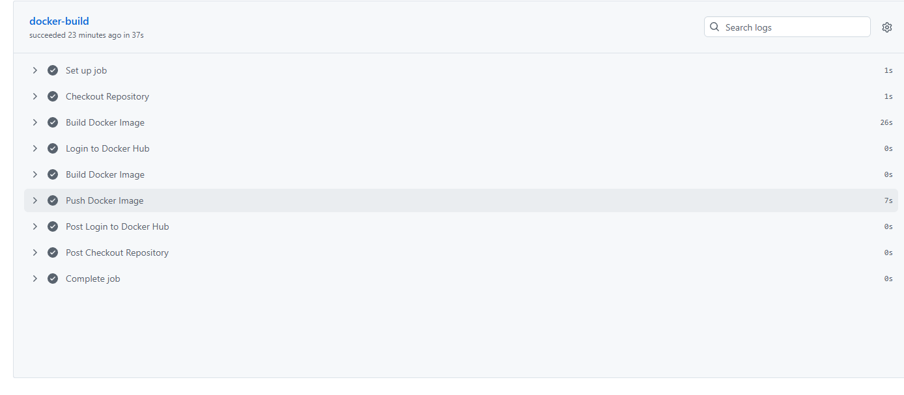
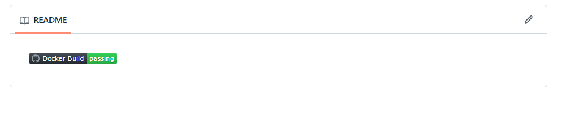

# Day 45 – Docker Build & Push in GitHub Actions

## Task
Today you build a **complete CI/CD pipeline** — code pushed to GitHub automatically builds a Docker image and ships it to Docker Hub. No manual steps.

This is exactly what happens in real production pipelines.
### Task 1: Prepare
Prepare the existing Spring Boot uberApp project for Docker CI/CD.
- Steps Performed:
- Verified the Spring Boot project builds successfully.
- Verified the Dockerfile is present in the project root.
- Built the Docker image locally.
- 
- 
### Task 2: Build the Docker Image in CI

#### Objective
  Automatically build the Docker image whenever code is pushed to the `main` branch.

### Workflow
 - Trigger workflow on push to `main`
 - Checkout the repository
 - Build the Docker image
 - 

### Task 3: Push to Docker Hub
 - Automatically push the Docker image to Docker Hub after a successful build.

 #### Steps Performed
  - Logged in to Docker Hub using GitHub Secrets.
  - Built the Docker image.
  - Tagged the image as latest.
  - Pushed the image to Docker Hub.
  - 
### Task 4: Only Push on Main
 - Steps Performed:
 - Updated the workflow trigger to run on every push.
 - Added a condition to the Docker push step.
 - Tested the workflow using a feature branch.
 - 
 - Verified that the Docker image was built but not pushed from the feature branch.
 - Merged the feature branch into main.
 - Verified that the Docker image was successfully pushed to Docker Hub.
 - 
### Task 5: Add a Status Badge
### Steps Performed

- Opened the workflow in the GitHub Actions tab.
- Generated the workflow status badge.
- Added the badge to the `README.md`.
- Committed and pushed the changes.
- 
### Task 6: Pull and Run It