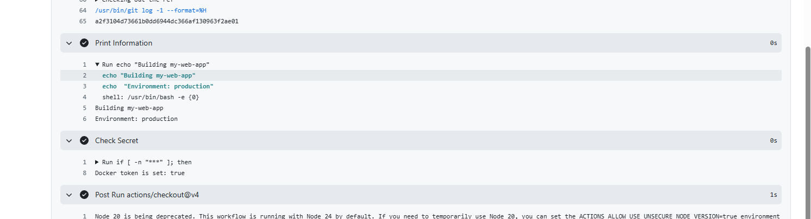
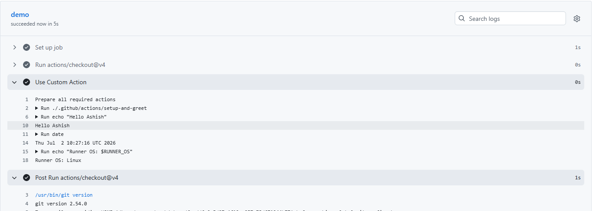

# Day 46 – Reusable Workflows & Composite Actions

## Task
You've been writing workflows from scratch every time. In the real world, teams **don't repeat themselves** — they create reusable workflows that any repo can call like a function. Today you learn `workflow_call` and composite actions.
### Task 1: Understand `workflow_call`
1. What is a reusable workflow?
 A reusable workflow is a GitHub Actions workflow that can be called by other workflows to avoid duplicating the same CI/CD logic across repositories.
2. What is workflow_call?
 workflow_call is a special trigger that allows one workflow to be invoked by another workflow instead of being triggered directly by events such as push or pull_request.
3. How is it different from a regular action?
 - Reusable Workflow:Contains one or more jobs,Triggered using workflow_call,Can accept inputs, outputs, and secrets.
 - Regular Action: Used inside a step,Used with uses: in a step,Performs a single reusable task.
4. Where Does It Live?
 - Reusable workflows must be stored in: `.github/workflows/`
### Task 2: Create a Reusable Workflow

### Objective

Create a reusable GitHub Actions workflow that can be called by other workflows.
### What I Learned

- A reusable workflow cannot run independently.
- It waits for another workflow to call it using `workflow_call`.
- Inputs and secrets are passed from the caller workflow.
- [Workflow](Workflows/reusable-workflow.yml)

# Task 3: Create a Caller Workflow

### Objective

Call the reusable workflow from another workflow.
### Steps Performed
- Created `call-build.yml`.
- Triggered the workflow on push to `main`.
- Called the reusable workflow using `uses`.
- Passed required inputs.
- Passed the Docker token secret.
- [text](Workflows/call-build.yml)

### Task 4: Reusable Workflow Outputs

### Objective

Return a value from the reusable workflow and use it in the caller workflow.

### Steps Performed

- Added a workflow output named `build_version`.
- Generated a version using the short Git commit SHA.
- Returned the output from the reusable workflow.
- Read the output in the caller workflow.
- Printed the version in a second job.

### What I Learned

- Reusable workflows can return outputs.
- Outputs are similar to return values in Java methods.
- Other jobs can access workflow outputs using `needs.<job>.outputs.<output-name>`.
- 
- [text](Workflows/reusable-outputs.yml)
- [text](Workflows/outputs.yml)
### Task 5: Create a Composite Action

### Objective

Create a custom composite action and reuse it in a workflow.

### Steps Performed

- Created `.github/actions/setup-and-greet/action.yml`.
- Defined inputs and outputs.
- Added multiple reusable steps.
- Created a workflow to use the custom action.
- Verified the greeting, date, and runner OS were printed.

### What I Learned

- A Composite Action groups multiple steps into a reusable action.
- It is invoked using `uses:` inside a workflow step.
- Composite Actions help eliminate duplicate steps across workflows.
- 
- [text](Workflows/composite.yml)

# Task 6: Reusable Workflow vs Composite Action

| Feature | Reusable Workflow | Composite Action |
|----------|-------------------|------------------|
| Triggered by | `workflow_call` | `uses:` in a workflow step |
| Can contain jobs? | Yes | No |
| Can contain multiple steps? | Yes | Yes |
| Lives where? | `.github/workflows/` | `.github/actions/<action-name>/action.yml` |
| Can accept secrets directly? | Yes | No (pass via inputs or environment variables) |
| Best for | Reusing complete workflows or pipelines | Reusing a group of common steps |