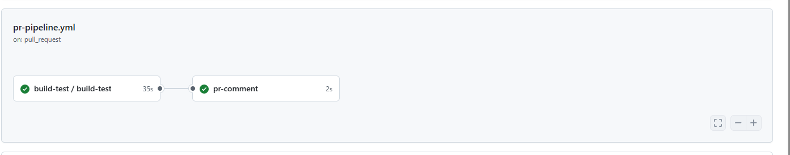
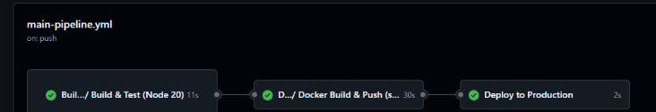
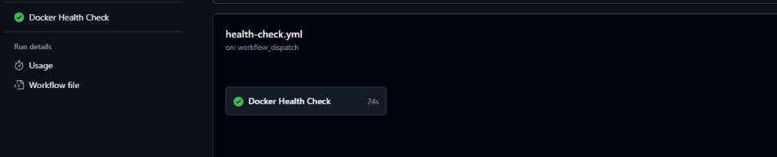

## Task
You've learned workflows, triggers, secrets, Docker builds, reusable workflows, and advanced events. Today you **put it all together** in one project — a complete, production-style CI/CD pipeline that builds, tests, and deploys using everything you've learned from Day 40 to Day 47.

## Overview

Today I built a complete CI/CD pipeline using GitHub Actions.

The goal was to combine the concepts learned from Day 40 to Day 47:

- GitHub Actions workflows
- Pull Request triggers
- Reusable workflows
- Workflow inputs and outputs
- Secrets
- Docker build and push
- Main branch pipeline
- Production environment
- Scheduled health checks
- Workflow dependencies
- GitHub Actions summary
## Challenge Tasks

# Task 1 – Set Up the Project

## What I Did

-  added my existing Spring Boot application to the `github-actions-practice` repository.
- I added the Maven project files, source code, tests, Maven Wrapper and Dockerfile.

#  Task 2 – Reusable Build & Test Workflow
- I created a reusable GitHub Actions workflow named reusable-build-test.yml.
- This workflow uses workflow_call, so other workflows can call and reuse it.
- I configured inputs for Java version and whether tests should run.
- This workflow does NOT deploy — it only builds and tests.
- [text](Scripts/Reusable-build-test.yml)
# Task 3 – Reusable Docker Build & Push Workflow

- I created a reusable Docker workflow named reusable-docker.yml.
- This workflow accepts the Docker image name and tag as inputs.
- Docker Hub credentials are passed securely using GitHub repository secrets:
- [text](Scripts/Reuseable-docker.yml)
# Task 4 – Pull Request Pipeline
- I created pr-pipeline.yml to validate code before it is merged into the main branch.
- The workflow triggers when a Pull Request is opened or updated.
- It calls the reusable Build & Test workflow.
- [text](Scripts/PR-Pipeline.yml)
-
# Task 5 – Main Branch CI/CD Pipeline
- I created main-pipeline.yml to handle the CI/CD process after code is pushed to the main branch.
- The pipeline connects the reusable Build/Test and Docker workflows.
- The execution order is controlled using needs:
- 
# Task 6 – Scheduled Health Check
- I created health-check.yml to periodically verify that the Dockerized application is healthy.
- 
# Task 7 – Documentation & Badges
- I documented the complete Day 48 project in this file.
- I also added workflow status badges to the repository README.
