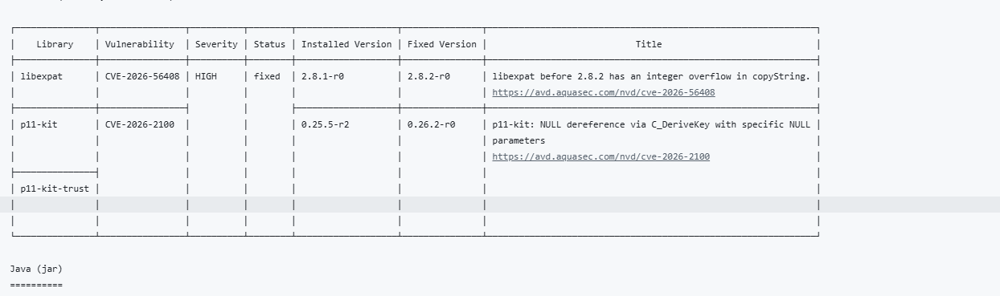
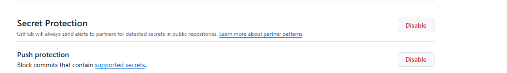
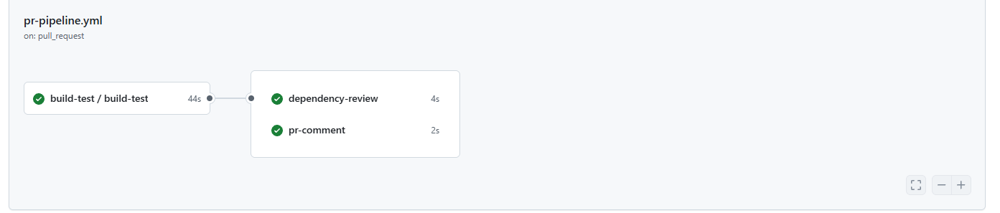

# Day 49 – DevSecOps: Add Security to Your CI/CD Pipeline

## What is DevSecOps?

## Challenge Tasks

### Task 1 – Scan Docker Image for Vulnerabilities

#### What I Did

I integrated **Trivy** into the reusable Docker workflow to scan the Docker image for known security vulnerabilities before pushing it to Docker Hub.

The pipeline now follows:

```text
Build Docker Image
        ↓
Trivy Security Scan
        ↓
PASS → Docker Push
FAIL → Push Blocked
```
- 
- [text](Scripts/docker-secuirty-scan.yml)

### Task 2: Enable GitHub's Built-in Secret Scanning
 #### What I Did

 I enabled GitHub's built-in Secret Scanning for the repository.

 I also enabled Push Protection where available so that GitHub can block a push when it detects a secret before the secret reaches the repository.

 Secret Scanning helps identify credentials that have already been committed, while Push Protection prevents the secret from being pushed in the first place.

 No workflow YAML changes were required for this task.
 - 

### Task 3: Scan Dependencies for Known Vulnerabilities
- I added GitHub's Dependency Review Action to the Pull Request pipeline.
- During the first run, the action reported that Dependency Review was not supported because the repository's Dependency Graph was disabled.
- I enabled Dependency Graph in the repository security settings and reran the PR workflow.
- The Dependency Review step then became available as part of the PR security checks.
- [text](Scripts/dependencyreview.yml)
- 
### Task 4: Add Permissions to Your Workflows
 #### What I Did

I added explicit permissions to my GitHub Actions workflows to follow the **Principle of Least Privilege**.

Instead of allowing workflows to access more repository permissions than required, I restricted them to read-only access for repository contents.

I added:

```yaml
permissions:
  contents: read
```
### Task 5 – Full Secure Pipeline

#### What I Did

Today I reviewed the complete CI/CD pipeline after adding the Day 49 security controls.

The Pull Request pipeline now performs:

```text
Pull Request
    ↓
Build & Test
    ↓
Dependency Review
    ↓
PR Checks
```